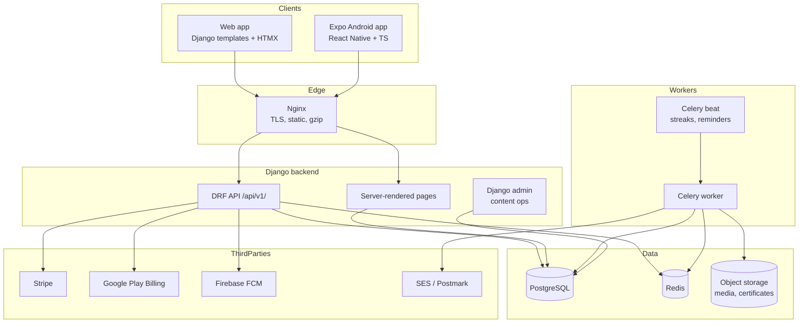

# Learn for Free Academy - Architecture

**Status:** Phase 0 (plan) - awaiting approval
**Date:** 2026-10-10
**Companion library:** `../learn-for-free` (36 PDF volumes, original notes)

---

## 1. Product summary

A paid micro-course platform (web + Android) that sells **one course per
technology for ~2 EUR**, with lesson quizzes, a final exam and a **verifiable
completion certificate**.

- Content source: the Markdown volumes in `../learn-for-free/src`.
- Business model: one-time in-app purchase per course (~2 EUR, configurable),
  optional "all courses" bundle, optional subscription as a later option.
- Principle: **the server is the only source of truth** for grading,
  entitlements, XP and certificates. The client never decides anything.

## 2. Stack

| Layer | Choice | Notes |
|-------|--------|-------|
| Backend | Python 3.12, Django 5 | split settings, `django-environ` |
| API | Django REST Framework + drf-spectacular | OpenAPI 3.1 schema in `/api/schema/` |
| Auth | SimpleJWT (access/refresh, rotation, blacklist) + Google/Apple social | custom email user model |
| DB | PostgreSQL 16 | JSON fields for flexible question payloads |
| Cache/queue | Redis 7 + Celery (beat) | streaks, exams expiry, emails |
| Web | Django templates + HTMX + Tailwind | SEO-friendly, PWA-ready, dark mode |
| Mobile | Expo (React Native) + TypeScript | Android first, iOS-ready |
| Payments | Stripe Checkout + Stripe Tax (web), Google Play Billing (Android) | server-side validation |
| Certificates | WeasyPrint + `qrcode` | PDF with QR linking to `/verify/<id>` |
| Infra | Docker Compose, Nginx, GitHub Actions, Sentry | `.env.example` driven |

## 3. System diagram



## 4. Django apps

| App | Responsibility |
|-----|----------------|
| `accounts` | custom user, profile, social login, verification, GDPR export/delete |
| `catalog` | courses, chapters, lessons, categories, levels, search, reviews |
| `learning` | progress, notes, bookmarks, resume point, lesson rendering |
| `assessment` | questions, choices, quiz attempts, exam attempts, grading |
| `payments` | orders, payments, entitlements, promo codes, Stripe/Play |
| `certificates` | certificate issuance, PDF, verification, revocation |
| `gamification` | XP events, levels, streaks, badges, leaderboard |
| `notifications` | in-app inbox, email, FCM push, preferences, device tokens |
| `content_import` | Markdown volume importer into courses/lessons/questions |

## 5. Data model (ERD)

```mermaid
erDiagram
    USER ||--o| PROFILE : has
    USER ||--o{ DEVICETOKEN : registers
    USER ||--o{ ENROLLMENT : owns
    USER ||--o{ ORDER : places
    USER ||--o{ QUIZATTEMPT : makes
    USER ||--o{ EXAMATTEMPT : makes
    USER ||--o{ CERTIFICATE : earns
    USER ||--o{ XPEVENT : earns
    USER ||--o{ USERBADGE : unlocks
    USER ||--o{ STREAK : keeps
    USER ||--o{ NOTE : writes
    USER ||--o{ BOOKMARK : sets
    USER ||--o{ REVIEW : writes
    USER ||--o{ NOTIFICATION : receives

    COURSE ||--o{ CHAPTER : contains
    COURSE ||--o{ ENROLLMENT : grants
    COURSE ||--o{ ORDER : sold_in
    COURSE ||--o{ CERTIFICATE : certified_in
    COURSE ||--o{ QUESTION : has_pool

    CHAPTER ||--o{ LESSON : contains
    LESSON ||--o{ QUESTION : quizzes_with
    LESSON ||--o{ LESSONPROGRESS : tracked_by

    QUESTION ||--o{ CHOICE : has
    QUESTION ||--o{ ATTEMPTANSWER : answered_in

    QUIZATTEMPT ||--o{ ATTEMPTANSWER : records
    EXAMATTEMPT ||--o{ ATTEMPTANSWER : records

    ORDER ||--o{ PAYMENT : settled_by
    ORDER ||--o| ENTITLEMENT : unlocks
    PROMOCODE ||--o{ ORDER : discounts

    USER {
        uuid id PK
        string email UK
        string name
        string timezone
        string locale
        boolean is_active
    }
    PROFILE {
        uuid id PK
        uuid user_id FK
        string display_name
        string avatar_url
        json preferences
        date certificate_name_locked
    }
    COURSE {
        uuid id PK
        string slug UK
        string title
        string technology
        string level
        string category
        int version
        string status
        int price_cents
        text description
    }
    CHAPTER {
        uuid id PK
        uuid course_id FK
        int position
        string title
    }
    LESSON {
        uuid id PK
        uuid chapter_id FK
        int position
        string title
        text markdown
        bool is_free_preview
        int minutes
    }
    QUESTION {
        uuid id PK
        uuid lesson_id FK "nullable"
        uuid course_id FK "exam pool"
        string type "mcq|truefalse|short|code_output"
        text prompt
        text explanation
        json code_block
        int difficulty
        int times_answered
        int times_missed
    }
    CHOICE {
        uuid id PK
        uuid question_id FK
        int position
        text body
        bool is_correct
    }
    QUIZATTEMPT {
        uuid id PK
        uuid user_id FK
        uuid lesson_id FK
        int score
        int max_score
        datetime submitted_at
    }
    EXAMATTEMPT {
        uuid id PK
        uuid user_id FK
        uuid course_id FK
        int score
        bool passed
        datetime started_at
        datetime expires_at
        json drawn_question_ids
    }
    ATTEMPTANSWER {
        uuid id PK
        uuid question_id FK
        uuid quiz_attempt_id FK
        uuid exam_attempt_id FK
        json payload
        bool is_correct
    }
    ENROLLMENT {
        uuid id PK
        uuid user_id FK
        uuid course_id FK
        string source "stripe|play"
    }
    ENTITLEMENT {
        uuid id PK
        uuid user_id FK
        uuid course_id FK
        bool active
        string reason
    }
    ORDER {
        uuid id PK
        uuid user_id FK
        uuid course_id FK
        int amount_cents
        string currency
        string status
        uuid promo_code_id FK
    }
    PAYMENT {
        uuid id PK
        uuid order_id FK
        string provider
        string provider_ref UK
        string status
        json raw_event
    }
    PROMOCODE {
        uuid id PK
        string code UK
        int percent_off
        int amount_off_cents
        datetime valid_until
        int max_redemptions
    }
    CERTIFICATE {
        uuid id PK
        uuid user_id FK
        uuid course_id FK
        string certificate_id UK
        int score
        int course_version
        bool revoked
        datetime issued_at
        string pdf_url
    }
    XPEVENT {
        uuid id PK
        uuid user_id FK
        string kind
        int amount
        uuid ref_id
        string idem_key UK
    }
    BADGE {
        uuid id PK
        string code UK
        string name
        json rule
    }
    USERBADGE {
        uuid id PK
        uuid user_id FK
        uuid badge_id FK
        datetime unlocked_at
    }
    STREAK {
        uuid id PK
        uuid user_id FK
        date last_active_date
        int current_length
        int best_length
    }
    NOTE {
        uuid id PK
        uuid user_id FK
        uuid lesson_id FK
        text body
    }
    BOOKMARK {
        uuid id PK
        uuid user_id FK
        uuid lesson_id FK
    }
    LESSONPROGRESS {
        uuid id PK
        uuid user_id FK
        uuid lesson_id FK
        bool completed
        int seconds
    }
    REVIEW {
        uuid id PK
        uuid user_id FK
        uuid course_id FK
        int rating
        text body
    }
    NOTIFICATION {
        uuid id PK
        uuid user_id FK
        string kind
        json payload
        bool read
    }
    DEVICETOKEN {
        uuid id PK
        uuid user_id FK
        string token
        string platform
    }
```



### Key invariants (enforced server-side)

- `ENTITLEMENT.active` is only set by a verified Stripe webhook or a validated
  Google Play purchase token. Never by the client.
- `CERTIFICATE` rows are created only by the exam grader when `passed` is true,
  and only once per (user, course, course_version) unless revoked.
- `XPEVENT.idem_key` is unique per (user, kind, ref) so XP cannot be farmed.
- `QUESTION.is_correct` choices are never serialised before an attempt is
  submitted.
- `EXAMATTEMPT` timestamps are server-set; `expires_at` is enforced on submit.

## 6. API spec (v1)

Base URL: `/api/v1/`. Auth: `Authorization: Bearer <access>` (SimpleJWT),
refresh via `/auth/refresh/` with rotation + blacklist. Errors follow
RFC 9457 problem+json. Cursor pagination on list endpoints
(`?limit=20&cursor=...`). All endpoints documented by drf-spectacular at
`/api/schema/` and `/api/docs/`.

| Method | Endpoint | Purpose |
|--------|----------|---------|
| POST | `/auth/register/` | email registration (sends verification) |
| POST | `/auth/login/` | email + password login |
| POST | `/auth/refresh/` | rotate refresh token |
| POST | `/auth/logout/` | blacklist refresh token |
| POST | `/auth/password/reset/` | request reset |
| POST | `/auth/password/reset/confirm/` | confirm reset |
| POST | `/auth/social/{google,apple}/` | exchange social token |
| GET/PATCH | `/me/` | profile read/update |
| GET | `/me/export/` | GDPR data export (async, emailed) |
| DELETE | `/me/` | GDPR account deletion (30-day grace) |
| GET | `/courses/` | catalog: `?q=`, `?level=`, `?category=` |
| GET | `/courses/{slug}/` | detail + syllabus + preview lesson |
| GET | `/courses/{slug}/lessons/` | ordered lessons (locked if not entitled) |
| GET | `/lessons/{id}/` | lesson markdown + payload |
| GET | `/lessons/{id}/quiz/` | questions **without** answers |
| POST | `/lessons/{id}/quiz/submit/` | grade, store attempt, return review |
| GET | `/lessons/{id}/quiz/attempts/` | history + best score |
| POST | `/courses/{slug}/exam/start/` | draw pool, start timer |
| GET | `/courses/{slug}/exam/{attempt}/` | attempt state + questions |
| POST | `/courses/{slug}/exam/{attempt}/submit/` | grade server-side |
| GET | `/courses/{slug}/exam/{attempt}/review/` | post-exam review |
| GET | `/progress/` | resume + per-course progress |
| POST | `/lessons/{id}/complete/` | mark lesson complete |
| GET/POST | `/lessons/{id}/notes/` | personal notes |
| GET/POST/DELETE | `/lessons/{id}/bookmark/` | bookmark |
| POST | `/payments/checkout/` | create Stripe Checkout session |
| POST | `/payments/webhooks/stripe/` | Stripe webhook (idempotent) |
| POST | `/payments/play/verify/` | validate Play purchase token |
| GET | `/certificates/` | my certificates |
| GET | `/certificates/{id}/pdf/` | download PDF |
| GET | `/verify/{certificate_id}/` | public verification |
| GET | `/gamification/me/` | XP, level, streak, badges |
| GET | `/gamification/leaderboard/` | opt-in weekly leaderboard |
| GET | `/notifications/` | inbox |
| POST | `/notifications/{id}/read/` | mark read |
| POST | `/devices/` | register FCM token |

`GET /lessons/{id}/quiz/` returns questions with choices **minus**
`is_correct`; the correct set is revealed only by
`POST .../quiz/submit/` and by `/exam/{attempt}/review/`.

## 7. Screens

### Web

| # | Screen | Notes |
|---|--------|-------|
| W1 | Home / landing | value prop, course grid, trust signals |
| W2 | Catalog | search, level/category filters, pagination |
| W3 | Course detail | syllabus, price, preview lesson, reviews |
| W4 | Lesson | markdown + code, prev/next, notes, bookmark |
| W5 | Lesson quiz | instant feedback + explanations |
| W6 | Final exam | timer, progress, submit |
| W7 | Exam result | score, pass/fail, review, certificate CTA |
| W8 | Certificate | view + share PDF |
| W9 | Verify | public `/verify/<id>` + OG preview |
| W10 | Profile | XP, level, streak calendar, badges |
| W11 | Login / register / verify / reset | email flows |
| W12 | Checkout | price, promo code, consent checkbox |
| W13 | Order success / receipts | invoice email link |
| W14 | Account settings | preferences, notifications, export/delete |
| W15 | Legal pages | privacy, terms, cookies, refund policy |
| W16 | Admin | courses, lessons, questions, orders, certificates |

### Mobile (Expo)

| # | Screen | Notes |
|---|--------|-------|
| M1 | Onboarding + auth | email + Google |
| M2 | Catalog | search + filters |
| M3 | Course detail | syllabus, purchase |
| M4 | Lesson | offline cached markdown, resume |
| M5 | Quiz | offline queue for submits |
| M6 | Exam | timer, submit |
| M7 | Result + certificate | share sheet |
| M8 | Profile / gamification | XP, streak, badges |
| M9 | Notifications inbox | push deep links |
| M10 | Settings | language, dark mode, account |

## 8. Content import pipeline

```
src/01-html.md
   -> parse front matter, chapters (#), sections (##), code fences
   -> Course(technology, level, price) 1:1
   -> Chapter  <-  "# How to use", "# Chapter N", "# Cheat sheet", ...
   -> Lesson    <-  "## " sections (concepts, examples, ...)
   -> Question pool:
        - "## Mini test" / "### Answer key" -> lesson quiz questions
        - "# Final test" + "# Final test answers" -> exam pool (30/vol)
   -> PDF attached to the course as a downloadable bonus after purchase
```

- Management command: `python manage.py import_volume path/to/01-html.md`
- Idempotent: upserts by `(course.slug, chapter.position, lesson.position)`;
  re-import creates a new course `version` and keeps old attempts intact.
- Question types: `mcq`, `truefalse`, `short`, `code_output` (answer parsed
  from the volume's answer key, so every question has an explanation).
- The importer never writes to `ENTITLEMENT`, grades or XP.

## 9. Non-functional requirements

| Area | Requirement |
|------|-------------|
| Security | OWASP top 10, rate limiting (DRF throttles), CSRF/CORS, secrets in env, `pip-audit`, audit log for payments/certificates |
| Legal | Privacy Policy, Terms, Cookie consent, refund policy (EU 14-day digital content), checkout consent text, Play data-safety notes |
| Accessibility | WCAG 2.1 AA web, screen-reader labels mobile, dark mode |
| Performance | pagination, `select_related/prefetch_related`, Redis cache, CDN for static/media, Lighthouse >= 90 |
| Quality | pytest + factory_boy, >= 80% backend coverage, contract tests, RNTL + Maestro smoke, ruff/black/eslint, pre-commit |
| Observability | structlog JSON logs, `/healthz`, Sentry, backup + migration strategy |

## 10. Milestones

| # | Milestone | Exit criteria |
|---|-----------|---------------|
| M1 | Foundation (auth, i18n, CI, Docker) | `docker compose up` works, tests pass, README setup in 5 commands |
| M2 | Content import + catalog + lessons | importer on 2 sample volumes, progress logic, permission tests |
| M3 | Quizzes + final exam | grading edge cases, attempt limits, timer expiry, no answer leakage |
| M4 | Payments + entitlements | webhook replay, refunds/revocation, Play validation, locked states |
| M5 | Certificates + verification | issuance only after pass, duplicate prevention, verify/revoked/unknown |
| M6 | Gamification + notifications | streak timezones/DST, XP idempotency, leaderboard privacy |
| M7 | Android app (Expo) | component tests + Maestro smoke flow |
| M8 | Hardening, legal, analytics, release | OWASP pass, GDPR pages, Lighthouse >= 90, RELEASE_CHECKLIST.md |

## 11. Risks

| Risk | Impact | Mitigation |
|------|--------|------------|
| Google Play 15-30% fee on a 2 EUR item | margin | bundle/subscription option, configurable prices |
| Copyright of source sites | legal | all notes original, no logos/branding of source sites, per-volume Sources |
| Answer leakage via API | cheating | grading server-side, no `is_correct` before submit |
| Streak timezone/DST bugs | retention + support | store `timezone` on user, compute in user tz, tests for DST |
| Stripe webhook replay / replay attacks | revenue | idempotency keys, provider-ref unique constraint |
| Certificate fraud | trust | unique IDs, QR, revocation, admin audit log |
| Scope creep (36 courses) | delay | one course live end-to-end (HTML) first, then clone |
| Mobile offline conflicts | data loss | server reconciliation with `updated_at` timestamps, last-write-wins for notes |

## 12. Decisions to confirm with the owner

1. Payment model: per-course only, or add the "all courses" bundle from day one?
2. Google Play Billing from day one, or Stripe-only until M7?
3. Email provider: SES or Postmark?
4. Analytics: PostHog (self-hostable) or Plausible?
5. Course content language: English only at launch (UI translated EN/ES)?
